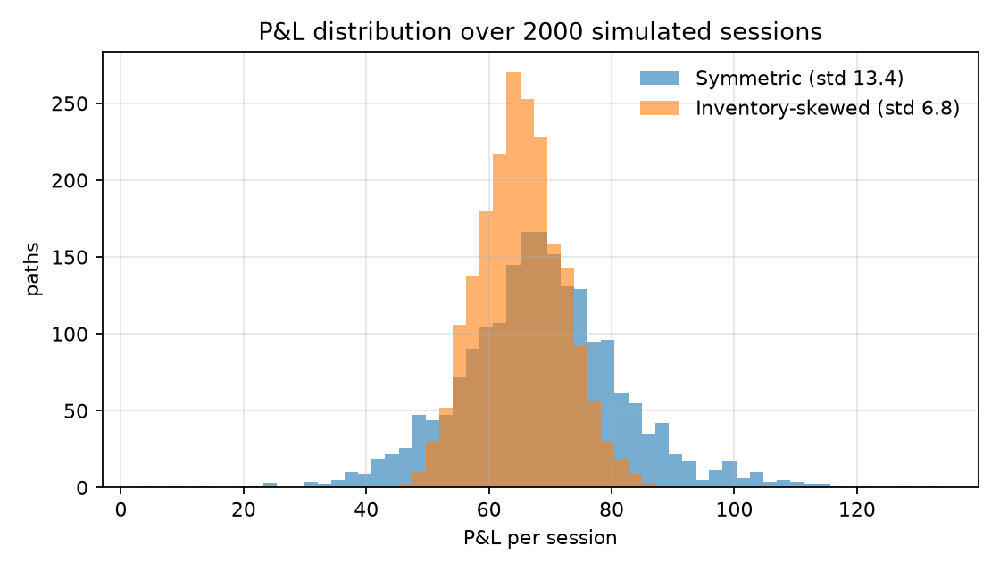
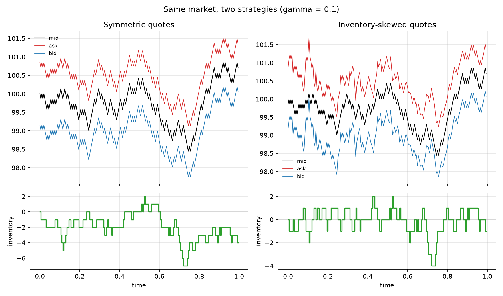
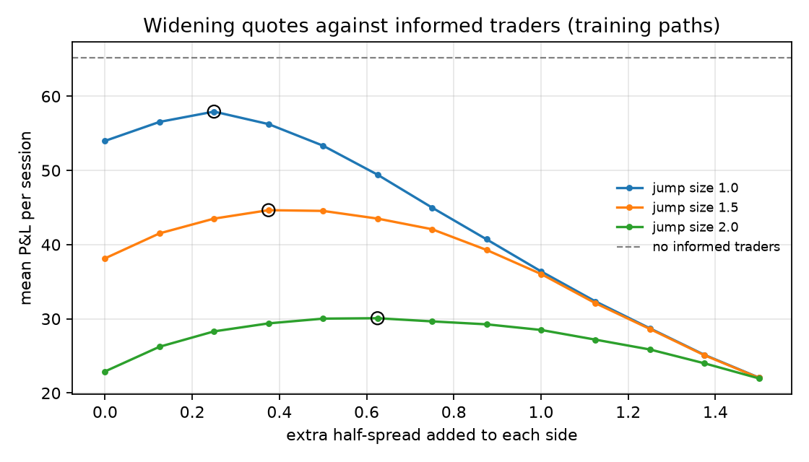

# Market-Making Simulator: Inventory Risk and Adverse Selection

A Monte Carlo simulator for a market maker quoting a bid and an ask on one asset.
It reproduces the qualitative inventory-management pattern of **Avellaneda & Stoikov (2008)**, then adds
**informed traders** who pick off stale quotes before price jumps, and measures how far quotes
should be widened to defend against them.

**Stack:** Python, NumPy, pytest, Matplotlib. 2,000 simulated sessions per strategy. Run times depend on hardware.

## The model

Each of 200 time steps in a trading session:

1. The market maker posts a bid and an ask.
2. **Informed traders:** if the price is about to jump and a quote is now on the wrong side of
   the new price, they trade 3 units against it.
3. **Noise traders:** a buy order lifts the ask with probability `A·exp(−k·δ)·dt`, where δ is the
   ask's distance from the mid (same for sells at the bid). Wider quotes earn more per trade but
   trade less often.
4. The mid price moves up or down by `σ√dt`, plus any jump.

Every strategy sees exactly the same simulated market (common random numbers), so differences
in results come from the strategy, not from luck.

P&L is split exactly into **spread P&L** (the edge earned on each fill) and **inventory P&L**
(gains and losses on the position as the price moves). A unit test checks that the two add up
to final cash plus inventory at the final price on every path.

## Strategies

- **Symmetric:** quotes centred on the mid, ignoring inventory.
- **Inventory-skewed (Avellaneda–Stoikov):** quotes centred on a *reservation price*
  `r = s − q·γ·σ²·(T − t)`. When long, it quotes lower to sell; when short, higher to buy.
  Total spread `γσ²(T − t) + (2/γ)·ln(1 + γ/k)`. γ is risk aversion.
- **Spread buffer:** either strategy plus an extra half-spread on each side.

## Results

### 1. Inventory skew halves risk at almost no cost (replicates Avellaneda–Stoikov)

| γ | Avg spread | Strategy | Mean P&L | P&L std | Final inventory std |
|---|---|---|---|---|---|
| 0.1 | 1.49 | Inventory-skewed | 65.2 | **6.8** | **3.1** |
| 0.1 | 1.49 | Symmetric | 68.5 | 13.4 | 8.5 |
| 0.01 | 1.35 | Inventory-skewed | 68.7 | 9.3 | 5.3 |
| 0.01 | 1.35 | Symmetric | 69.1 | 13.7 | 8.8 |
| 0.5 | 2.16 | Inventory-skewed | 48.7 | 6.0 | 2.0 |
| 0.5 | 2.16 | Symmetric | 58.6 | 11.5 | 7.2 |

With γ = 0.1, skewing quotes gives up 5% of mean P&L and cuts P&L volatility by half. Higher γ
lowers risk further but costs more profit. This matches the pattern in the original paper.




### 2. Informed traders cut profit by 41%; the jumps alone do not

With price jumps of 1.5 (5% chance per step) and informed traders taking 3 units. The
**jumps-only control** uses exactly the same jumps, but nobody knows about them in advance,
which separates the effect of jumps from the effect of informed trading.

| γ = 0.1 | Mean P&L | P&L std | Loss to informed traders |
|---|---|---|---|
| No jumps, no informed traders | 65.2 | 6.9 | 0 |
| Jumps only (control) | 65.3 | 9.6 | 0 |
| Jumps + informed traders | 38.2 | 13.7 | −23.0 |
| Jumps + informed traders, symmetric quoter | 45.4 | **45.1** | −22.8 |

Jumps on their own add risk but cost nothing on average, because they are equally likely to
go either way. The whole drop in mean P&L comes from informed traders, who only trade when the
jump is about to go against the market maker.

Inventory skew matters even more here: the symmetric quoter never unloads the positions informed
traders leave it with, so its P&L volatility is more than three times higher (30.2 with jumps
alone, 45.1 with informed traders).

### 3. The right spread buffer depends on how toxic the flow is

Widening quotes protects against informed traders but also loses noise-trader business, so
mean P&L peaks at an interior buffer. The buffer was **chosen on one set of 2,000 simulated
sessions and evaluated on a fresh set**, so the improvement is not from fitting noise.

| Jump size | Buffer chosen (training) | Test P&L, no buffer | Test P&L, with buffer | Change | Loss to informed traders |
|---|---|---|---|---|---|
| 1.0 | 0.25 | 53.8 | 58.1 | **+8%** | −8.7 → −3.0 |
| 1.5 | 0.375 | 38.0 | 44.5 | **+17%** | −22.6 → −12.1 |
| 2.0 | 0.625 | 22.7 | 29.4 | **+29%** | −37.4 → −19.2 |

The more informed the flow, the wider the optimal quotes and the bigger the gain from widening.



## Testing

16 tests in `tests/`, including:
- the spread and reservation-price formulas against hand calculations
- exact P&L accounting (spread + inventory = cash + marked inventory) with and without jumps
- simulated fill rates match the arrival model `A·exp(−kδ)·dt` within 2%
  (this test caught a real counting bug: adding two boolean arrays in NumPy is a logical OR)
- informed traders never trade when quotes are wider than the jump
- inventory limits are never breached, even by multi-unit informed trades, which are cut to
  the room left under the limit
- jumps without informed traders leave mean P&L unchanged (the control experiment)
- all strategies see identical markets

## Run it

```bash
pip install -r requirements.txt
python -m pytest -q
python scripts/run_experiments.py      # writes reports/results.json and figures
```

## Limitations

- Prices are a random walk with jumps; real order books have queues, partial fills and latency.
- Informed traders are modelled as knowing the jump one step early; real informed flow is
  noisier and must be detected from order flow.
- The spread buffer is fixed for a session; a real market maker would adapt it as toxicity changes.

## Reference

Avellaneda, M. and Stoikov, S. (2008). High-frequency trading in a limit order book.
*Quantitative Finance*, 8(3), 217–224.

## Review clarifications

This implementation uses at most one noise fill per side and time step, with a clipped Bernoulli probability `min(1, A*exp(-k*delta)*dt)`. It is a discrete-time approximation motivated by a Poisson intensity, not exact Poisson arrival-count simulation. Results do not establish an exact numerical replication of the continuous-time paper. Aggressive quotes can saturate the probability cap.

`informed_pnl` reports the execution edge versus the post-jump midpoint. It is a diagnostic, not a third additive P&L component and not a subset of spread P&L. The accounting identity is final cash plus marked inventory = spread P&L + inventory P&L. Peak inventory now includes exposure immediately after informed trades, before noise fills can offset it.

The 8-29% buffer gains are on fresh simulated seeds under the same assumed model. They are not out-of-sample market-data returns. A single train/test seed pair does not quantify all Monte Carlo uncertainty.

Developed with AI coding assistance. See `WALKTHROUGH.md` before using the project in interviews.
